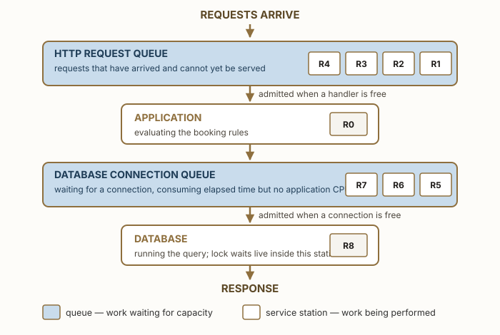
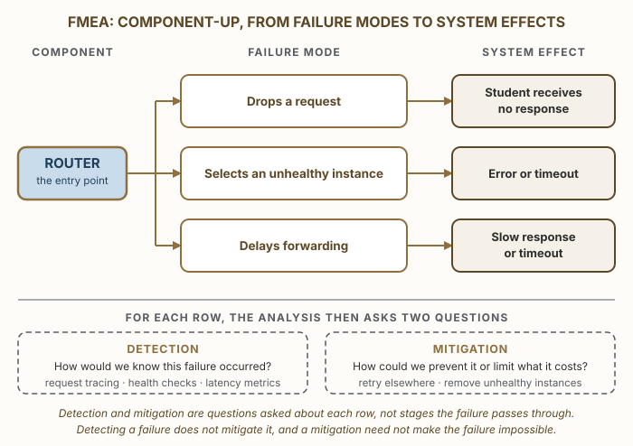
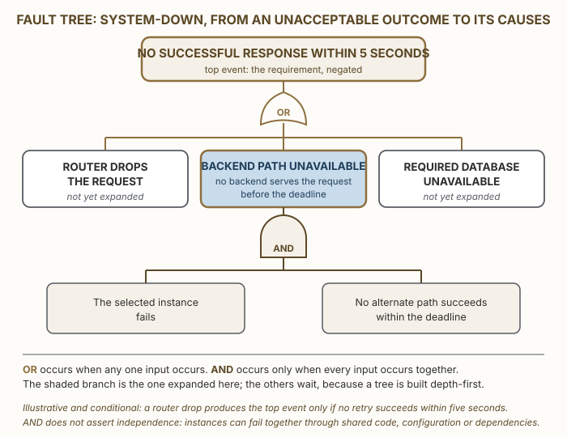

**Premise.** *Functional correctness does not establish that a system will behave acceptably under load, or that it will continue to satisfy its obligations when components fail. Engineers must understand the workloads and failure modes their systems will encounter, select appropriate designs and mechanisms, and obtain evidence that the result meets its requirements.*

Software systems are assembled from components that execute work, preserve state, communicate, and coordinate activity. Each component provides capabilities, consumes resources, and carries characteristic failure modes. A database may lose a write, a message broker may deliver a message twice, and a worker may exhaust its memory. Failures also arise from interactions among components that are individually behaving as specified. A service may be correct when tested in isolation yet become unusable when its users arrive simultaneously, or when another component on which it depends stops working.

Performance and reliability examine different aspects of these problems. **Performance engineering** examines the relationship between workload, resource consumption, and observable behavior. It asks whether the system can perform the work required of it within acceptable time and resource bounds. **Reliability engineering** examines what can fail, how failures affect the assembled system, and which mechanisms can prevent, contain, detect, or recover from them. Both require us to reason beyond individual functions and consider the system in its operating environment.

Both also require engineering judgment. The engineer decides which workloads and failures matter, what behavior is acceptable, and what evidence would establish that the system provides it. A model can predict how waiting increases as a resource approaches capacity, but it cannot decide what latency users should tolerate. A fault tree can identify conditions that produce an unacceptable outcome, but it cannot decide how much redundancy is worth purchasing.

## Structure of this unit

**Lecture 1, Performance Engineering.** We begin with a service that passes its functional tests but becomes unusable when many students attempt to make reservations. We model requests moving through queues and service stations, characterize the workload, and examine waiting as demand approaches capacity. We then use measurements to locate the limiting resource, compare interventions, and establish whether an improvement worked. Configuration tuning, optimization, and additional capacity are alternatives whose value depends on workload, environment, and cost. See {exercise:improve-reservation-performance} and {lab:performance-lab}.

**Lecture 2, Reliability Engineering.** We begin with the software hardware store: components and their characteristic failure modes. We introduce two complementary engineering models: failure mode and effects analysis (component-up) and fault-tree analysis (system-down). We then examine isolation, detection, recovery, redundancy, containment, and state protection; investigate component selection and its assumptions; and apply fault-tree analysis to the architecture of your semester project.

Both lectures follow the Act III method: identify the problem, model what matters, exercise judgment about realization, and obtain evidence.

## Lecture 1: Performance Engineering

### Performance engineering

Registration begins, requests arrive at forty times their usual rate, and students start receiving timeouts. The software has not changed. What has?

Our reservation service passes its functional tests. It can create reservations, enforce booking rules, preserve data across restarts, and respond correctly to ordinary requests. Yet none of those tests establishes what happens when four hundred students attempt to book rooms during the same two minutes. A system can be fully implemented and still be unready for its users. The 2013 launch of Healthcare.gov offers a well-known example: many users could not complete enrollment, and subsequent investigations identified interacting software, integration, testing, and operational problems. Capacity was one concern among several. The engineering question is what evidence should have established beforehand that the *integrated* service could perform its function under expected demand.

Performance engineering examines how a system behaves under a workload. Before changing the implementation, we need to know what work arrives, what resources the system uses to perform it, and what performance we require. We also need to distinguish a service that responds too slowly from one that may eventually exhaust resources and stop responding altogether. Those problems are related, but they do not necessarily call for the same intervention. A service with insufficient capacity may need more resources; one that spends most of its time waiting for a database lock may not benefit from additional application servers.

Three measurements recur. **Latency** is elapsed time to complete an operation. **Throughput** is completed work per unit time. **Utilization** describes how much of a resource's capacity is in use. None substitutes for the others. A service can complete many requests per second while some users wait unacceptably long, and low CPU utilization does not establish that other resources have spare capacity. A connection pool may be saturated while application and database processors remain relatively idle. The engineer must determine which measurement answers the question at hand.

### Modeling the system

A useful first model represents the system as a network of queues and service stations. Requests arrive, wait for resources, undergo processing, and eventually complete. A reservation request might wait for an application worker, execute booking logic, wait for a database connection, execute a query, and wait for a row lock. Each stage contributes to elapsed response time, but not every stage consumes the same resources. Some stages perform computation; others primarily represent waiting for capacity.

Waiting consumes elapsed time without necessarily consuming application CPU. A request waiting for a database connection is not making progress, even if the application processor has spare capacity. Adding application workers may increase the number of requests waiting for that connection without reducing the time any request spends there. The model helps us ask a better question than whether the system is generally busy: *Where can work accumulate, and which resources limit its progress?*

Queues also explain how performance problems become failures. Suppose 120 requests arrive each second while a processor completes 100. If those rates persist and no work is rejected, the backlog grows by about twenty requests per second. After one minute, roughly 1,200 requests are waiting. A bounded queue eventually refuses additional work, preserving its resource bound at the cost of rejecting requests. An unbounded in-memory queue may continue consuming memory until the system exhausts its resources. Rejection is not successful service, but it may prevent a larger failure.

The engineer must understand not only which components exist, but where work can accumulate, what limits each resource, and what happens at those limits. This is an engineering model because it represents selected properties of the system for a particular analysis, rather than every implementation detail.

### Characterizing the workload

A system model describes how work is processed. A workload model describes the work arriving. For the reservation service, offered workload includes request rate, operation mix, and variation over time. Searches and bookings may arrive at the same rate but impose very different demands on the database. A search might perform a short index lookup, while a booking must validate rules, acquire a lock, and commit a transaction. Registration also produces bursts absent during ordinary use. Provisioning for the average afternoon is insufficient if users depend on the service during the busiest hour of the semester.

| Property | Role in the model | Engineering question | Reservation example |
|---|---|---|---|
| Request rate | Offered workload | How often does work arrive? | Requests per second |
| Operation mix | Offered workload | Which kinds of work arrive, in what proportion? | Searches, bookings, cancellations |
| Variation | Offered workload | How does demand change over time? | Registration bursts |
| Service demand | Implementation and environment | What resources does one operation consume? | Database time per booking |
| Concurrency | Imposed in some tests; otherwise an outcome | How much work overlaps? | Active requests at once |

These are not five independent settings. Request rate, mix, and variation describe what the environment asks the system to do. Service demand depends on the implementation and environment: changing an index may reduce demand per request without changing the offered workload. Concurrency may be imposed by a closed-loop load generator, but in a running service it is often an observed consequence of throughput and response time.

A performance requirement is meaningful only against a stated workload. A service that satisfies a one-second latency requirement during an ordinary afternoon may fail it during registration. A benchmark exercising only searches cannot establish performance for a workload dominated by bookings. Latency is also a distribution: median latency describes the middle request, while p95 and p99 expose increasingly slow portions. A requirement that 95% of requests complete within one second cannot be evaluated from mean latency alone. The percentile and workload belong to the requirement, not to post-hoc interpretation.

### Relating workload, concurrency, and capacity

**Little's Law** relates three measured averages for a stable system: **L = λW**. Here L is the average number of requests in the system, λ is average throughput, and W is average time in the system. At 100 completed requests per second and 0.2 seconds per request, approximately twenty requests are outstanding on average. If response time rises to one second at the same throughput, average outstanding work rises to one hundred. The law is useful for estimating average concurrency and checking measurements, but it does not identify where requests wait or independently predict how waiting changes with load.

For prediction we need service capacity and assumptions about arrival and service processes. A simple M/M/1 queue assumes one server, Poisson arrivals, exponentially distributed service times, and a stable queue. Under those assumptions mean response time is **W = 1/(μ − λ)** for **λ < μ**, where λ is arrival rate and μ is service rate. As arrival rate approaches capacity, predicted waiting rises sharply even though the server performs each operation at the same speed. At 99% utilization a burst can produce a backlog that takes considerable time to drain.

Real services have multiple resources, variable operation costs, bursts, and complicated scheduling behavior. The M/M/1 model does not describe all of them. Its value here is explaining why latency can rise nonlinearly near capacity; it does not prescribe a universally safe utilization threshold. The engineer chooses a threshold based on the latency requirement, workload variation, and cost. In {lab:performance-lab}, predict before each experiment, then compare the observation with the model and its assumptions.

### Measuring and diagnosing performance

A system model tells us where waiting *could* occur. Instrumentation tells us where it *actually* occurs. A trace records operations involved in servicing a request. Recording entry and exit from queues, and start and end of processing, distinguishes waiting from work. Correlated spans reconstruct the request path across components. On a sequential path, nonoverlapping durations can be added; with overlapping operations, the trace must also represent their relationships.

Different instruments answer different questions. CPU-time profiling identifies where processor time is consumed. Tracing exposes elapsed time across operations, including waiting. Resource metrics reveal utilization, saturation, and errors; database execution plans explain the work of individual queries. A CPU-time profile accounting for 61 milliseconds does not explain a request that takes 420 milliseconds: the difference may be time waiting for a database query, connection, or lock.

A **bottleneck** is the constraint whose relief would improve useful throughput or bring response time within the required bound. It is not necessarily the component with highest CPU utilization, and a saturated resource does not automatically identify the correct intervention. If every database connection is occupied while CPU utilization remains modest, adding application replicas may only increase the queue. The next measurement should establish *why* connections remain occupied: slow queries, lock waits, long transactions, or connections retained unnecessarily. A full pool tells us where to investigate, not that the pool must be larger.

Relieving one bottleneck often exposes another. After reducing query time, application CPU or a row lock may become the limiting resource. Improvement is iterative: measure, change, and measure again. The objective is not to eliminate every expensive operation, but to establish that the system satisfies its requirements under the relevant workload.

### Improving performance

Once the limiting cost is understood, several kinds of intervention are available. The question is not which optimization is fashionable, but which resource cost the current constraint requires us to reduce. **Configuration tuning** changes how existing components operate: worker concurrency, connection-pool size, queue limits, cache capacity, and timeouts. Parameters interact. More concurrency may increase throughput until a shared resource saturates; shorter timeouts may reduce client waiting while increasing failures. A configuration validated today may be inappropriate when the workload changes.

Tuning can be framed as choosing a configuration that balances latency and operating cost while satisfying constraints on errors, memory, connections, and other resources. Engineers may transfer settings from similar systems, search combinations, or automate experiments. An agent can propose configurations and run tests, but the workload and acceptance conditions must be established independently of the search. Otherwise, it may optimize a convenient metric while violating the actual requirement.

Other optimizations change the work. **Caching** avoids repeated computation or retrieval; **batching** amortizes fixed overhead; **algorithms and data structures** reduce work per operation; **parallelism** overlaps independent work; **placement** reduces data transfer; and **streaming** bounds the resident working set. Each has conditions and costs. A cache introduces staleness and invalidation; batching adds buffering and latency; parallelism can increase contention; streaming can reduce peak memory without reducing CPU or elapsed time. The engineer must identify the scarce resource and the cost the technique actually changes.

**Autoscaling** changes available capacity rather than work per request. It helps only when an additional instance provides useful capacity. Replicas in front of a saturated shared resource may make waiting worse. Scaling also takes time, so sudden bursts must initially be absorbed by headroom, admission control, or advance provisioning.

The environment changes the decision. Embedded systems may have fixed memory, deadlines, power, and thermal budgets; optimization may be necessary for feasibility. Cloud systems can often buy capacity, but at recurring cost and subject to shared bottlenecks and quotas. Engineering effort and infrastructure spending are partially substitutable: a $4,000 optimization that saves $400 monthly breaks even after ten months, before maintenance, demand growth, and risk. The fastest implementation is not necessarily the economically preferable one. Performance engineering selects an implementation and configuration that satisfy the requirement at an acceptable cost.

### A case study: DocAble

Chapter 4 of *Model-Based Agentic Engineering* follows a performance problem in DocAble, a document-accessibility remediation system. A media-heavy PowerPoint presentation of roughly 250 MB exceeded a worker's available memory. The initial architecture retained document structure and media together, and manipulating the document could create further copies. Small presentations worked; large ones failed. Page chunking reduced the working set but left media resident within each chunk. The problem was not merely insufficient memory: the representation unnecessarily coupled structural processing to media residency.

The solution changed that representation. Skeletonization separated document structure from large media, leaving references in the worker and streaming media when needed. Resident memory became less dependent on aggregate media size, subject to assumptions about structural size, streaming buffers, and active state. This traded worker memory for storage access and implementation complexity, appropriate because worker memory was the scarce resource.

The change illustrates **active alignment**: a memory model states an obligation, measurements reveal violations, and implementation changes are evaluated against the model. The engineer establishes the obligation and acceptance evidence. Agents can investigate and implement candidate solutions, but they do not determine what the system must guarantee. Once acceptable behavior is established, checks can preserve it during later changes: **passive alignment**.

### Establishing that an improvement worked

An optimization is not complete when one benchmark improves. Establish acceptance conditions *before* testing: perhaps p95 latency at or below one second during registration, sufficient completed throughput, bounded pool waiting, and controlled overload behavior. A user-facing latency requirement is different from a diagnostic pool-wait target. The workload must reproduce relevant operation mix, concurrency, bursts, data size, and cache state; repeated measurements characterize variation. After a change, measure again because the bottleneck may have moved. See {exercise:improve-reservation-performance}.

Performance and reliability meet at overload. Bounded queues, admission control, and timeouts can protect resources but may reject work or leave clients uncertain about outcomes. Retrying failed requests can increase load on an already saturated service. The next lecture examines what the system owes when components fail and how to establish that recovery is acceptable.

## Lecture 2: Reliability Engineering

### Reliability engineering

A system can satisfy its functional specification and still fail when a component stops working. A database becomes unavailable, a worker crashes, or a router sends traffic to an unhealthy service. The component failure may be straightforward to describe, but its effect depends on the architecture. A worker crash might fail one request, leave a partial transaction, exhaust a shared resource, or trigger recovery that affects other requests. Reliability engineering asks whether the *assembled system* continues to satisfy its obligations under specified failures.

We must distinguish failures that are acceptable from failures that violate a requirement. A service that promptly rejects a request during overload may be behaving as designed; a service that acknowledges a successful reservation and then loses it has violated a stronger obligation. There are also limits to what we can guarantee. Redundancy, recovery, and isolation cost resources and engineering effort. The CAP theorem establishes that during a network partition a distributed system cannot guarantee both linearizable consistency and availability in the theorem's formal sense. We must choose what behavior matters under which failures, not pretend that partitions can be prohibited.

The task is not to prevent every conceivable failure. It is to identify those that matter, determine achievable guarantees, and select mechanisms that provide them under explicit assumptions. Knowing that a cloud service offers retries, replication, or health checks is not enough; we must understand what each mechanism guarantees, which failures it addresses, and what happens when its assumptions fail.

### Components and their failure modes

Software engineers rarely build systems entirely from scratch. We assemble components that execute code, preserve data, exchange messages, coordinate access, accelerate operations, and direct work. Each solves a problem and introduces dependencies and failure modes. Think of a **software hardware store**: a physical store offers many ways to fasten, support, or protect things; software platforms offer many ways to provide capabilities. The vocabulary is overwhelming until we organize the options by what they do. Six broad categories cover many contemporary components.

| Category | Representative components | Characteristic failure modes |
|---|---|---|
| **Compute** | Processes, containers, serverless functions | Crashes, hangs, resource exhaustion |
| **Storage** | Filesystems, databases, object stores | Lost writes, corruption, unavailable data |
| **Communication** | HTTP/RPC, message brokers, event streams | Message loss, duplication, delay |
| **Coordination** | Locks, schedulers, consensus services | Deadlock, stale ownership, double ownership |
| **Acceleration** | Caches, CDNs, connection pools | Stale results, eviction, cache stampedes |
| **Control** | Load balancers, orchestrators, service discovery | Incorrect routing, stale service information, gray failures |

These are functional categories, not mutually exclusive product types. A database stores and coordinates through transactions and locks; a message broker communicates and may persist data. The classification helps us ask which capability we rely on and which characteristic failures it brings. For instance, two threads each need two locks. One acquires lock A and waits for B; the other acquires B and waits for A. Both threads may obey their local rules, but together they deadlock. A consistent lock-acquisition order is a system-level control on their interaction, not a correction to one isolated function.

Other failures arise among components behaving according to specification. A cache returns an old value while the database holds a newer one. A client retries an operation that already committed because the response was lost. Two replicas share a database whose failure disables both. Reliability cannot be established by testing each component separately. The assembled system has properties and failure modes determined by relationships among its parts.

Failures may be hard to observe, propagate across boundaries, or depend on timing that is difficult to reproduce. A component can keep responding while returning incorrect data; a slow dependency can cause callers to exhaust their own resources; a rare concurrency interleaving can escape thousands of tests. Tests establish what happened in particular executions, not that every possible failure has been considered. For systematic reasoning, we need engineering models.

### Modeling failures

There are two complementary starting points. Begin with a **component** and ask what could happen if it fails, or begin with an **unacceptable system outcome** and ask what events could produce it. These approaches are *failure mode and effects analysis* (FMEA) and *fault-tree analysis* (FTA). They differ not merely in diagram notation, but in their engineering questions and the information they require. FMEA uses a component model to trace possible failures toward system effects. FTA begins with a top event, often obtained by negating a requirement, and works backward through the architecture. Both produce representations that can be inspected, revised, and used to select controls.

#### Failure mode and effects analysis: Component-up

FMEA begins with a model of the system's components. Select a component, identify ways it might fail, and trace the consequences through the system. Then ask how each failure could be detected and what could prevent it or limit its consequences. A mitigation need not make failure impossible; it may reduce likelihood, duration, or damage.

Consider the reservation service. A student submits a request to a router, which forwards it to one of two reservation-service instances. The selected instance accesses a database. Suppose the router intermittently misbehaves: it might drop a request, select an unhealthy instance, or delay forwarding. The student may experience no response, an error, or a timeout. **The router dropping a request is a component failure mode; the student receiving no response is a system effect.** One observable effect may arise from several failures, and a timeout does not establish that the reservation never committed: the response may have been lost after a successful write.

| Component | Failure mode | System effect | Detection | Candidate mitigation |
|---|---|---|---|---|
| Router | Drops a request | Student receives no response | Request tracing, missing completion | Safe retry through another route |
| Router | Selects an unhealthy instance | Error or timeout | Health checks, error metrics | Remove unhealthy instances from routing |
| Router | Delays forwarding | Slow response or timeout | Latency measurements | Bound queueing and forwarding time |

The same failure can have different consequences in different architectures. A router serving an optional recommendation feature may degrade the experience without preventing reservations; a router that is the only entry point may make the whole service unavailable. FMEA therefore cannot be filled in from a component catalog alone. It requires a model of the component's place in the architecture and the recovery behavior around it.

The analysis can also prioritize work. Traditional FMEA considers severity, occurrence, and detectability; qualitative judgments suffice here. A severe, poorly detectable failure may warrant controls even if its likelihood is unknown. A frequent but inconsequential failure may not justify an expensive mitigation. The goal is an engineering decision, not a spurious numerical risk score.

#### Fault-tree analysis: System-down

FTA starts from the other direction. Select an unacceptable outcome and work backward to events that could produce it. A practical way to identify top events is to examine requirements and consider their violation. If a reservation request must receive a successful response within five seconds, the top event is **No successful response within five seconds**. We then consult the architecture: the router might drop the request; the backend path might become unavailable without timely recovery; the required database might become unavailable. Each is a *candidate* sufficient explanation, subject to assumptions about retries, alternate paths, and the deadline.

A fault tree uses Boolean relationships. An **OR** gate means any input event suffices for the parent event; an **AND** gate means all inputs are required. These are claims about causation in the modeled architecture, not merely ways to arrange boxes. If two independently usable request paths exist, both must fail for that route-level redundancy to be lost. If both paths share a required database, database failure may defeat them together. The tree must reflect those relationships.

The assumptions matter. If a router detects a failed backend and retries another instance successfully before the deadline, failure of the first backend is not sufficient for the top event. A tree claiming otherwise is wrong for that architecture. Nor does an AND gate imply statistical independence: replicas can fail together because of shared code, configuration, power, or dependencies. Independence must be established separately before multiplying probabilities.

FTA makes the conditions for an unacceptable outcome explicit. We can inspect which paths are already controlled, which need mitigation, and which assumptions need evidence. When architecture or recovery policy changes, the tree changes too. Adding fallback may convert a single failure into a conjunction of failures; that is a property of the *system*, not of the component considered alone.

#### Constructing and using the models

Both analyses reuse engineering models we should already have. The engineer chooses an abstraction appropriate to the decision. Treating an entire application as one component might suffice for analyzing loss of a machine but not interactions among internal services. For **FMEA**, begin with architecture or component models; select a component, enumerate relevant failure modes, trace effects, and consider detection and mitigation. Repeat across the components that matter. The direction is component-up.

For **FTA**, begin with a requirement and formulate its violation as an observable top event. Use the architecture and component failure models to identify causes, then decompose them with justified AND and OR relationships. **Work depth-first**: follow one plausible causal path to events concrete enough to analyze or control before expanding sibling branches. Stop when further detail would not change the engineering decision. The direction is system-down.

| Dimension | FMEA | Fault tree |
|---|---|---|
| **Direction** | Component-up | System-down |
| **Representation** | Components, failure modes, effects | Events and Boolean relationships |
| **Properties examined** | Consequences, detectability | Conditions producing an unacceptable outcome |
| **Assumptions** | Component behavior, architecture | Dependencies, recovery behavior |
| **Analyses** | Trace effects, identify gaps, prioritize | Identify causal paths and combinations |

Neither model is automatically complete or correct. FMEA may omit components or interactions; a fault tree may omit causes or choose the wrong gate. Both can become outdated as the architecture changes. Their value is that they make claims about failure behavior explicit enough to inspect and act upon. This is why we construct engineering models elsewhere in the course: representations support analyses, and analyses support decisions.

### Engineering for reliability

Once relevant failures are understood, we can choose mechanisms to prevent them, detect them, contain their effects, or restore operation. Software borrows many metaphors from physical engineering: containers isolate, bulkheads prevent damage spreading, watchdogs detect problems, and circuit breakers interrupt interactions with unhealthy dependencies. The metaphors are helpful, but what matters is the guarantee each mechanism actually provides.

| Purpose | Representative mechanisms | Engineering role |
|---|---|---|
| **Isolation** | Containers, bulkheads, resource limits | Limit what a failure can affect |
| **Detection** | Health checks, heartbeats, watchdogs | Recognize failed or unhealthy components |
| **Recovery** | Restart, retry, failover | Attempt to restore operation |
| **Redundancy** | Replication, diverse implementations, N-version programming | Provide alternative ways to perform work |
| **Containment** | Circuit breakers, admission control, backpressure | Prevent propagation or overload |
| **State protection** | Transactions, idempotency, backups | Preserve or recover required state |

The mechanisms are not interchangeable. Isolation does not necessarily detect failure; detection does not repair it; recovery may repeat work or encounter the same defect; redundancy depends on sufficiently independent alternatives. Consider a worker emitting heartbeats. A watchdog may restart it after a missed heartbeat, but the worker might merely be slow and continue operating. If both the old and replacement workers believe they own a shared resource, the recovery protocol creates a correctness failure. Stronger ownership rules, such as fencing, may be needed. The mechanism must be evaluated as part of the assembled system.

**Redundancy and diversity** also differ. Replication can survive the loss of an instance, but identical replicas share implementation defects. N-version programming uses independently developed implementations and may compare results, at greater cost; independence of development does not guarantee independent failures. The engineer must say which failure class redundancy is intended to tolerate.

**Retries and backoff** show how a locally reasonable mechanism can destabilize a system. A timeout says only that the caller stopped waiting, not that the operation failed to commit. Retrying state-changing work requires an idempotency policy. If many clients retry together, they amplify load on a struggling dependency. Backoff reduces retry frequency; jitter spreads attempts; retry budgets and admission control limit aggregate work. The goal is not to install every mechanism, but to select those that address modeled failures under valid assumptions.

### Selecting and integrating components

Component selection is itself an engineering decision. When we integrate a library, database, broker, cloud service, or other dependency, its behavior becomes part of the assumptions on which our system relies. We need to investigate more than advertised features. A component may perform its intended function correctly while consuming unacceptable resources, failing under concurrency, or offering weaker recovery guarantees than the application needs.

This distinction is especially important with AI coding agents. An agent can identify a library, install it, integrate its API, and run tests. The tests may all pass. That establishes only behavior under the conditions tested; it does not establish suitability for the actual workload, environment, and reliability obligations. **Unless the engineer supplies those constraints explicitly, the agent has no reliable basis for evaluating them.** Functional correctness and **contextual appropriateness** are distinct engineering obligations. A dependency suitable for a desktop application processing trusted inputs may be unacceptable for a public service processing untrusted requests, even if it functions as specified in both.

| Dimension | Questions for the engineer |
|---|---|
| **Functional semantics** | What behavior is guaranteed? Which inputs, outputs, and edge cases are specified? |
| **Resource bounds** | What time, memory, storage, and communication costs arise? Are worst-case bounds documented? |
| **Failure modes** | Can it hang, crash, corrupt state, or return incorrect results? |
| **Recovery guarantees** | What happens after failure? Are retries safe? Can partial work be recovered? |
| **Concurrency behavior** | What synchronization, ordering, and isolation guarantees apply? |
| **Security** | How are untrusted inputs handled? What attack surfaces are introduced? |
| **Maintainer practices** | How are defects fixed and vulnerabilities disclosed? Which versions receive updates? |
| **Compatibility and evolution** | Can the dependency be upgraded, constrained, or replaced without violating requirements? |

Not every dependency needs an exhaustive investigation. The depth of analysis should reflect consequences and dependence: a library formatting an optional report deserves different scrutiny from one validating security-sensitive input or preserving transactions. The engineer identifies which properties matter in context and obtains evidence. Documentation may describe functions without worst-case resource bounds or failure behavior. **The absence of a documented limitation is not evidence that the limitation does not exist.** If a property matters and is unspecified, investigate it or impose an independent control.

#### Case study: Regular expression engines

Regular expression engines illustrate the problem. Applications treat matching as an operation returning success or failure. An AI agent asked to validate a field can select a regex library, integrate it, and write tests showing that ordinary valid and invalid inputs are handled correctly. From a functional perspective, the implementation may appear complete. But matching consumes time and memory, and the engine's implementation determines which patterns and inputs are expensive. Some backtracking engines exhibit exponential worst-case execution time for particular pattern/input combinations; other approaches trade execution time for memory. These properties may be inconsequential for short trusted inputs on a desktop computer and unacceptable for attacker-controlled inputs in a public service.

Three questions matter: Can a pattern and input cause excessive execution time? Can matching consume excessive memory? Does the engine produce the intended match or mismatch? Controls include choosing an engine with appropriate complexity guarantees, restricting pattern features, bounding input and pattern sizes, isolating execution, enforcing resource limits, and testing against intended semantics.

Bhuiyan, Cakar, and Davis's *SoK: Regular Expression Denial of Service* examined regex engines in nine widely used programming languages. They found that backtracking engines can exhibit super-linear worst-case behavior and that relevant defenses and limitations were often undocumented. Maintainers have sometimes regarded such behavior as an accepted consequence of supporting extended regex features rather than a defect requiring correction. A component can therefore function as its maintainers intend while remaining unsuitable for the system in which an engineer proposes to use it.

This is why component selection cannot be delegated merely by asking an agent to find a library that works. The agent can search documentation, compare alternatives, construct benchmarks, and test candidates. Those are useful delegated tasks. **The engineer must supply the workload, trust boundary, resource budget, required guarantees, and consequences of failure.** Without that context, passing tests and successful integration are weak evidence of suitability. The engineer is responsible for the assembled system, not merely the functional correctness of individual components.

### Selecting reliability mechanisms

The same scrutiny applies to reliability mechanisms. A mechanism may be correctly implemented yet fail to provide the intended guarantee because an assumption does not hold. The table summarizes several common choices and the conditions under which they can help.

| Failure | Candidate mechanism | Required assumption |
|---|---|---|
| Process crash | Restart | State can be recovered |
| Transient network failure | Retry | Repetition is safe |
| Persistent dependency failure | Circuit breaker | Caller can fail or degrade |
| Machine failure | Replication | Failures are sufficiently independent |
| Duplicate message | Idempotency | Operation identity is stable |
| Data loss | Backup and recovery | Recovery point is acceptable |

A retry is unsafe when repeating an operation violates an invariant; replication cannot tolerate a shared failure that disables every replica; and a backup cannot satisfy a recovery obligation if the newest recoverable state is too old. The engineer must evaluate the mechanism against the modeled failure, then test whether its assumptions hold in the assembled system.

### Apply the analysis to your project

Begin with the engineering models your team has already developed: architecture, deployment topology, component dependencies, and requirements. Choose a representative request and define successful completion. The top event is **Your system cannot produce a successful response within ten seconds.** Construct a fault tree for that outcome, working depth-first along one causal path before expanding other branches. Use OR and AND gates only where the architecture justifies them. Account explicitly for redundancy, retries, recovery, and fallback: a component failure does not necessarily produce a system failure when another path can complete within the deadline.

Inspect the tree's assumptions against your models. Are dependencies represented accurately? Does the retry actually occur? Is the alternate path independent? Could a shared dependency disable both? Finally, identify one inadequately controlled failure path and **propose a mitigation mechanism**, stating which event it addresses and what assumptions must hold. **Ten minutes, with your project team. Deliverable: fault tree, assumptions, and one mitigation.**

### Engineering judgment

Performance and reliability are properties of the assembled system. A change that improves one may weaken the other: retries can recover transient failures while increasing load, and admission control can protect accepted work by refusing other requests. The engineer must evaluate these interactions against the requirements and operating environment, not merely the behavior of individual components.

The next unit, Security Engineering, examines how an adversary can deliberately produce undesirable outcomes in the same architecture.
