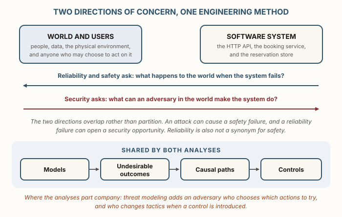
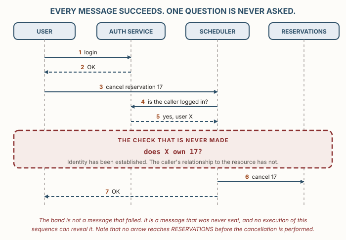
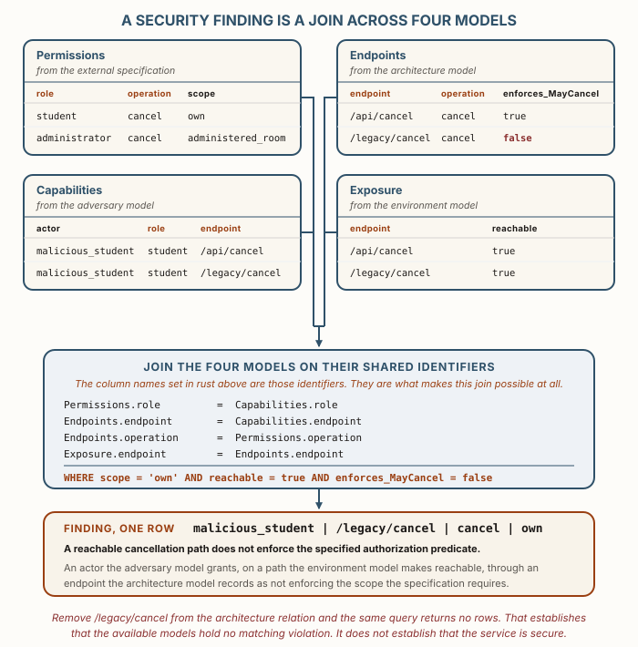
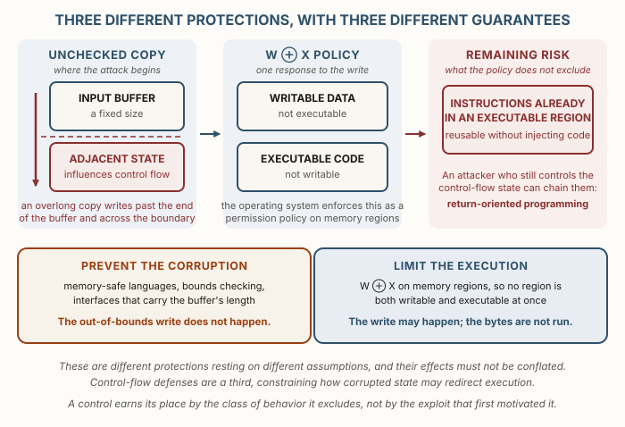
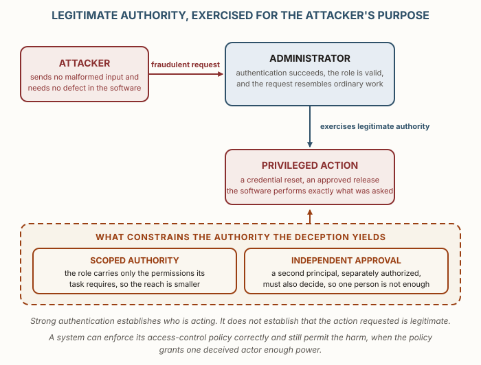
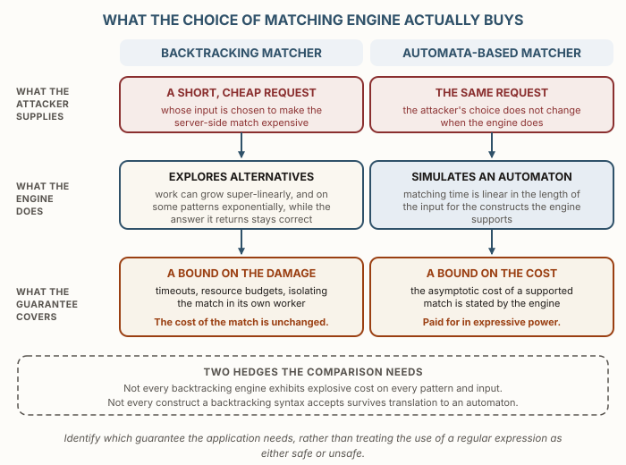
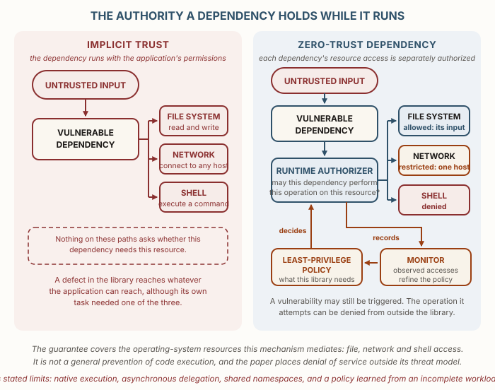
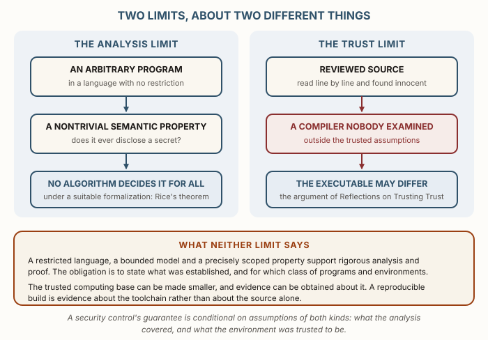
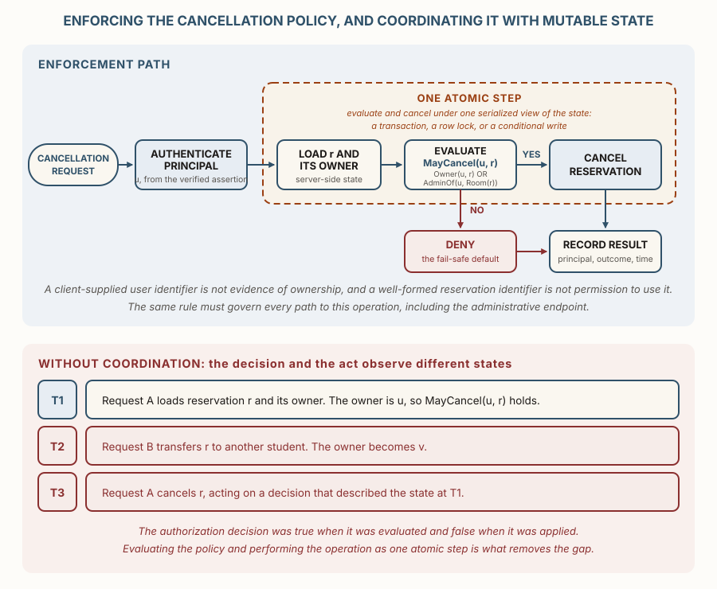

*How can an adversary violate a system's obligations, and what would justify believing our defenses work?*

**Premise.** *Security engineering examines systems whose inputs, identities, dependencies, and operating conditions may be manipulated deliberately. Engineers must combine models of the system, its obligations, its environment, and its adversaries to identify threats; select software controls that constrain possible attacks; and obtain evidence for the protection those controls actually provide.*

The campus reservation service now has an architecture, a deployment, persistent data, and performance and reliability models. We have asked whether requests complete on time and how component failures could prevent the system from satisfying its obligations. Those questions remain relevant, but security introduces a participant whose objective may be to make the system fail. An authenticated student may deliberately submit another student's reservation identifier. A malicious input may consume an extraordinary amount of CPU time. A dependency that was installed to parse a document may be induced to execute a command. In each case, the attacker is looking for a behavior that the engineer did not intend to authorize.

Reliability and security therefore share much of their method. Both identify unacceptable outcomes, trace causal paths through a system, and select mechanisms to prevent, detect, contain, or recover from them. FMEA starts from components; fault trees start from system-level failures. Threat modeling adds an adversary who chooses actions and adapts to controls. The familiar distinction between safety and security is useful here: *Can the system harm the world?* versus *Can an adversary in the world harm the system?* These are not strict opposites. A security attack can cause a safety failure, and a reliability failure can create a security opportunity. Nor is reliability synonymous with safety. The distinction is a way to recognize why a familiar engineering analysis needs a different model of the environment.



Security is also a problem of judgment. A finite threat model cannot enumerate every attacker strategy, and a passing test suite cannot establish protection against every possible attack. The engineer must decide which assets and obligations matter, which attacker capabilities are plausible, which controls provide useful guarantees, and what evidence justifies relying on them. The adversary is not obliged to follow the examples in our tests or the assumptions we forgot to write down.

## Structure of this unit

**Lecture 1, Threat Modeling.** We begin with an apparently correct reservation service and ask whether an authenticated user can cancel somebody else's reservation. The example introduces the distinction between authentication and authorization, concrete threat statements, and several ways to reduce security risk without necessarily changing the implementation. We then identify the assets worth protecting, model adversary capabilities and motivations, construct data-flow diagrams, and use STRIDE to search systematically for threats. A denial-of-service example connects adversarial resource consumption to the preceding Performance and Reliability unit.

The extended material develops risk prioritization, joins models of specifications, architecture, adversaries, and deployment into an executable analysis, and examines what happens when a model omits a relevant path. These topics can be taught as a continuation or studied independently. See {exercise:threat-model-cancellation}.

**Lecture 2, Controls & Assurance.** We begin with two attacker objectives, changing data and executing code, then use the Common Weakness Enumeration (CWE) to investigate the weaknesses that can make those outcomes possible. Four technical cases connect attacks to software controls: memory corruption and W⊕X, social engineering and identity management, ReDoS and linear-time matching, and vulnerable dependencies and zero-trust resource permissions. We close with fundamental limits on assurance and a claim, control and evidence exercise. See {exercise:secure-cancellation} and {lab:redos}.

## Lecture 1: Threat Modeling

### From reliability failures to adversarial threats

In the previous unit, we constructed a fault tree for the event No successful response within ten seconds. A router could drop a request, a backend could crash, or a database could become unavailable. The same outcome can also be produced deliberately: an attacker might submit inputs that exhaust CPU, overwhelm a queue, or exploit a dependency to disrupt service. The unacceptable outcome has not changed, but our model of how it can occur has expanded. Security introduces an adversary who selects actions strategically and may change tactics when a defense is introduced.

A threat model is not simply a list of things that might go wrong. It represents what we want to protect, what the system permits, where an attacker can interact with it, and what the attacker is assumed able to control. These assumptions matter as much as the diagram. An unauthenticated internet client, an authenticated student, a compromised administrator, and a malicious software dependency have different capabilities. A model that silently treats them as interchangeable will produce misleading security conclusions.

### Worked example: cancel somebody else's reservation

Suppose a student authenticates through the university identity provider and then asks the reservation service to cancel reservation 17. The scheduler checks that the student is logged in, receives confirmation, and cancels the reservation. Every step succeeds. Is the system behaving correctly?



Put that question to a class before naming any defect and the first proposals concern the authentication mechanism. An adversary might attempt logins repeatedly until one succeeds. An adversary might impersonate the authentication service and return a forged confirmation. The drawing answers the second: the scheduler does not take the caller's word for who they are, it asks the authentication service, so that path stays closed for as long as the service answers correctly. The first names a real threat, but it belongs to the identity provider, which this diagram treats as a trusted dependency rather than as part of the system. Neither proposal was wasted. Checking a failure hypothesis against the model is the activity, and a hypothesis the model deflects shows what the model is currently assuming.

The discovery arrives when the specification is stated out loud. A reservation belongs to somebody, and every reservation in the database is associated with people who have the authority to modify it. Set that property beside the drawing and the question becomes *"Does this flow? Is it aware of that property?"* Nothing in the sequence consults the store that records ownership. The authentication service reports that the caller is user X, and the step that should follow is the one the class then named: *"Does X own 17?"*

One habit makes this kind of discussion productive. When a student answers "it depends," ask what it depends on. The answer is almost always a fact about the system that the analysis has not yet represented, which is to say that an honest "it depends" locates the next thing the model needs.

Authentication establishes the caller's identity. It does not establish the relationship between the caller and the resource being modified, so if reservation 17 belongs to another student the cancellation violates the specification even though the authentication mechanism works correctly.

The missing obligation is not merely to check permissions in general. The server must establish that the requesting principal owns the reservation or holds administrative authority over the room. The distinction matters because a student may legitimately cancel one reservation and be forbidden from canceling another. Written as a predicate, the obligation reads:

> MayCancel(u, r) = Owner(u, r) OR AdminOf(u, Room(r))

This is already more precise than saying that "administrators can cancel reservations," because it names the resource relationship each principal must stand in. A check that only asks whether the caller holds an administrator role does not establish the scope the policy requires. The same predicate returns in Lecture 2, where we ask what mechanism can enforce it.

A useful threat statement resembles a bug report, but records additional information about the adversary. A bug report arranges a state, takes an action, and asserts what should then be true. A threat statement keeps that structure and adds the actor and the conditions that let the action succeed, which gives it five elements: the actor, entry point, action, enabling condition, and consequence. For the cancellation example, an authenticated student submits another student's reservation identifier to `POST /api/reservations/{id}/cancel`. Because the endpoint checks identity but not ownership, the request cancels a reservation the student does not control.

The enabling condition is especially important. "Unauthorized cancellation" describes an undesirable outcome; "the endpoint checks authentication but not ownership" identifies the condition that permits it. The engineer can then investigate whether that condition exists on each path to the cancellation operation, which is a question an implementation can be inspected against.

### One threat, several possible controls

The direct repair is to enforce the authorization predicate on every path that reaches the cancellation operation. But an organization may also consider other ways to reduce the threat. It could require confirmation from the reservation owner, restrict access to the campus network, make reservation identifiers difficult to discover, or use audit records and disciplinary procedures to deter misuse. These measures do not provide equivalent guarantees.

| Proposed measure | What it changes | Does it enforce the original authorization property? |
|---|---|---|
| Owner confirmation | Requires independent approval | Yes, if correctly enforced |
| Unpredictable identifiers | Reduces target discovery | No |
| Campus network or VPN | Reduces exposure | No |
| Logging and investigation | Improves detection and accountability | No |
| Disciplinary consequences | May deter identifiable attackers | No |

The column that matters is the third one. These are not five solutions to the same problem; they are four different changes plus one repair. The distinction is between preventing an unauthorized operation, reducing the attacker's opportunity to attempt it, detecting misuse after the fact, and discouraging an identifiable actor from attempting it. Unpredictable identifiers may make targets harder to discover, but they do not establish authorization. A VPN may restrict exposure, but an authenticated insider can still exploit the endpoint. An audit log may establish who submitted a request, but it cannot undo the cancellation.

Security engineering therefore requires judgment about more than software defects. The engineer must identify what each control changes, which adversaries remain capable of attacking once it is in place, and what residual risk the organization will accept. Several of these measures are cheaper and faster than a code change, and an organization under time pressure will reach for them first. That can be a sound decision, and it is still not a repair. Accepting a compensating control does not mean the vulnerability has disappeared; it means the organization has made a risk decision under stated assumptions. Those assumptions are what a later reviewer must check, because when one of them lapses the exposure returns with no code having changed, and nothing in the system announces it.

### Identifying assets worth protecting

Before asking what an adversary can do, decide what is worth protecting: *"What are the assets that this system manipulates?"* The first answer is the reservation records themselves. Notice what an attacker who alters them has accomplished: the service is still available and the records are still present, but they can no longer be trusted. The most fundamental asset of a reservation system is the trustworthiness of its reservations, and the loss here is of integrity rather than availability.

An analysis that stops at application data will miss the adversary with no interest in reservations at all. *"What they actually care about is being able to use your computer to run code."* The target may be compute capacity, for mining or for a botnet that attacks somebody else. It may be the credentials the service holds for an external provider, spent on that provider's bill under the organization's account. It may be the organization's identity, used to make a message or a release appear trustworthy. Systems that actuate physical equipment extend the list further, into consequences that no later software change can undo.

| Asset | Example adversarial objective |
|---|---|
| Reservation records | Change or disclose another user's booking |
| Compute capacity | Run unauthorized workloads or exhaust service resources |
| Administrative authority | Perform privileged operations |
| Credentials and API tokens | Consume external services under the organization's account |
| Organizational identity | Impersonate trusted communications or releases |

Naming the assets changes which parts of the system deserve examination. An analysis that protects only the reservation table will not ask who can reach a deployment credential. An analysis that protects only confidentiality will not ask what an attacker gains by making a record untrustworthy rather than by reading it.

### Modeling the adversary

An adversary model specifies more than who might attack. It describes the capabilities available to that actor and the assumptions under which the analysis is performed. An unauthenticated client may submit requests to public endpoints. An authenticated student can invoke student operations and choose their parameters. A compromised administrator may exercise legitimate administrative authority for an illegitimate purpose. An insider may know implementation details unavailable to ordinary users.

The engineer must also consider the adversary's resources and motivation. An opportunistic attacker may use readily available tools against many targets. A criminal organization may invest in infrastructure and specialized expertise because successful attacks produce revenue. A state-sponsored actor may sustain a campaign for strategic reasons. These categories do not determine capability by themselves, but they help establish plausible assumptions about the effort an attacker may expend against this system in particular.

| Adversary category | Typical motivation | Relevant capabilities or resources |
|---|---|---|
| Opportunistic individual | Curiosity, disruption, personal benefit | Public tools, limited access, variable expertise |
| Disgruntled insider | Retaliation, financial gain | Internal knowledge, legitimate credentials |
| Professional contractor or mercenary | Payment | Specialized expertise, tools, time |
| Criminal organization | Financial gain | Coordinated operations, purchased access, infrastructure |
| State-sponsored actor | Strategic or intelligence objectives | Sustained effort, specialized capabilities, substantial resources |
| AI-assisted attacker | Depends on the human or organization directing it | Automated exploration, scalable attempts, tool use |

These are illustrative categories, not a ranking of inherent competence. An individual researcher may be more technically capable than a poorly resourced organization.

Motivation, resources, and capability are related, and treating any one as a proxy for the others will mislead. Attack feasibility is therefore not a property of the vulnerability alone, and a defect that is infeasible for one of these actors may be routine for another.

Knowledge is a separate dimension again. An attacker may know only the public interface, may inspect open-source dependencies, or may obtain internal source code and architecture information. A system whose security depends on the attacker remaining ignorant of an implementation detail is relying on an assumption that may fail, and that usually fails quietly. Security analyses should therefore state what the attacker is assumed to know, rather than treating undocumented behavior as inaccessible.

The purpose of this model is not to enumerate every possible attacker. It is to establish which capabilities the system must withstand and which are outside the current analysis. Those exclusions must be explicit, because they determine which threat statements are meaningful and which conclusions the analysis is entitled to draw.

### Data-flow diagrams and trust boundaries

Three models are now in hand and each answers a different question. The asset model identifies what matters. The adversary model identifies what the attacker controls. A data-flow diagram identifies where those capabilities can affect the protected resources, which is the question neither of the other two can answer on its own.

A **data-flow diagram (DFD)** records external actors, processes, data stores, and the flows connecting them. For the reservation service, the diagram includes students and administrators, the HTTP API, the booking service, the identity provider, and the reservation store. A trust boundary marks where assumptions about identity, integrity, or authority must be reconsidered. It is not necessarily a machine boundary: two components on one host may run with different privileges, and two hosts may share one authority.


The DFD should be selective rather than exhaustive. It must show the paths by which an attacker-controlled value reaches a consequential operation, the source of identity assertions, and the authority carried by services that access the reservation store. If the diagram omits a legacy endpoint, an administrative workflow, or a background job that can cancel reservations, it cannot support a complete analysis of cancellation authorization. Existing architecture, deployment, and data models should be reused wherever possible, rather than redrawn independently and allowed to drift.

Drawing the diagram is also when the remaining elements of the security model get named, because the diagram will not hold together without them.

| Security-model element | Engineering question | Example |
|---|---|---|
| Asset / protected property | What matters, and to whom? | Reservation integrity; private student data |
| Adversary | Who may seek to violate it? | Authenticated student |
| Capability | What can that actor control? | Request parameters and timing |
| Entry point | Where can the actor interact with the system? | The student cancellation endpoint |
| Trust boundary | Where does an assumption about authority change? | Client input enters server-side execution |
| Dependency | Which outside service or component is trusted? | Identity provider and its signing keys |
| Assumption | What must be true for the analysis to hold? | All cancellation paths are represented |

### Searching for threats with STRIDE

The cancellation defect was found by asking one good question about one drawing. That does not scale, and it does not generalize to the threats nobody happened to think of. **STRIDE** supplies six prompts to apply in turn: spoofing, tampering, repudiation, information disclosure, denial of service, and elevation of privilege. It is most useful when applied to particular elements and flows, not as a label attached to the whole application. At the client-to-API boundary we might ask whether the caller can impersonate another principal; at the API-to-database boundary, whether a service account can modify records outside its intended scope.

Like FMEA, STRIDE examines a model element by element; the difference is that its questions concern adversarial violations rather than accidental failure modes. The procedure is the same one the Performance and Reliability unit used, pointed at a different kind of cause.

| STRIDE prompt | Concrete reservation-service question | Property at risk |
|---|---|---|
| Spoofing | Can a request be accepted as another student? | Authentication |
| Tampering | Can a student alter somebody else's reservation? | Integrity |
| Repudiation | Can a cancellation be denied without reliable evidence? | Accountability |
| Information disclosure | Can one student retrieve another's private reservation details? | Confidentiality |
| Denial of service | Can repeated requests exhaust booking capacity? | Availability |
| Elevation of privilege | Can a student invoke an administrator-only operation? | Authorization |

A STRIDE label is not yet a threat statement. The six prompts produce candidates; what records a candidate is the five-element statement used earlier for the cancellation defect, naming the actor, entry point, action, enabling condition, and consequence. "Tampering" alone cannot be examined against an architecture, translated into a policy, or tested. The elevation-of-privilege row is the prompt that would have found the cancellation defect without anyone needing to notice it first.

### Resource exhaustion: a small input and a large cost

The denial-of-service prompt is where this unit meets the previous one, and it covers two attacks that an engineer should not treat alike. A distributed flood costs the attacker real resources. Controlling enough machines to saturate a service is a purchase, and the defender's spending and the attacker's spending rise together; an organization that can buy capacity, filtering, and admission control can often answer it with money. An algorithmic complexity attack is asymmetric. A short request induces work that grows super-linearly in its length, so the attacker spends bytes and the defender spends CPU, and buying capacity buys very little. A backtracking regular-expression engine is the standard instance. The Cloudflare outage of July 2019 demonstrates the weakness without any attacker at all: one rule carrying a pathological expression, deployed globally, saturated CPU across the network. The distinction to carry away is between attacker effort and defender resource consumption, because it decides whether more capacity is a defense or a postponement. Lecture 2 develops the control, and {lab:redos} measures the behavior directly.

The core of Lecture 1 ends here. The three sections that follow extend the same analysis rather than beginning a new subject: how to decide which of the threats found this way deserves a response, how the models that produced them can be combined mechanically, and what such an analysis cannot establish however well it is executed. The closing exercise draws on both halves.

### Extended analysis: prioritizing threats

Threat identification and risk analysis are related but distinct. A threat statement describes a possible violation. Prioritization asks whether the violation matters enough to warrant a particular response, considering consequences, attack feasibility, exposure, existing protection, and cost. The alternatives examined earlier are what prioritization chooses among: the question is rarely whether to repair the endpoint in the abstract, but which combination of prevention, exposure reduction, detection, and deterrence the organization will fund this quarter, and what each combination leaves unaddressed.

| Risk consideration | Information required | Models to consult |
|---|---|---|
| Consequence | Which requirement is violated and what is affected? | Specification, data, stakeholders |
| Feasibility | Can this adversary reach and exercise the weakness? | Adversary, architecture |
| Exposure | Under which deployment conditions is the opportunity available? | Deployment, environment |
| Existing protection | What actually constrains the attack? | Controls, enforcement paths |
| Cost of response | What changes and what does it cost? | Design, operations |

Every row of that table is a question about a model, which is why prioritization cannot be settled by scoring alone. An administrator credential compromise may have greater consequences than disclosure of one reservation identifier, but its plausibility depends on how credentials are issued, protected, and revoked. A numerical score computed without those facts records a judgment rather than supporting one.

### Extended analysis: joining security models

The cancellation finding drew on information from several models at once, and it is worth naming them before combining them mechanically. The **external specification** states which cancellations are permitted. The **architecture** identifies endpoints and the enforcement paths they use. The **adversary model** states which requests and parameters an attacker controls. The **environment model** states which endpoints are reachable in the deployed system. The data model supplies the ownership and room-administration relationships. None of these models, considered alone, establishes the complete threat.

| Model | Question it answers | Reservation-service fact |
|---|---|---|
| External specification | What behavior must be permitted or forbidden? | Students cancel only their own reservations; administrators act only within their room scope |
| Architecture / implementation | Which paths reach the protected operation, and what checks do they perform? | A student cancellation endpoint and an administrative one |
| Data model | Which relationships determine authorization? | `Owner(user,reservation)`, `Room(reservation)`, `AdminOf(user,room)` |
| Adversary model | Which actions and inputs can the attacker choose? | Authenticated student can choose a reservation identifier |
| Environment / deployment | Which paths can that actor reach? | A student credential reaches the student endpoint from anywhere the service is published |

Models become particularly useful when their entities have identifiers that permit their information to be combined. Consider four small relations drawn from the models above. The `enforces_MayCancel` field records whether an endpoint's complete enforcement path implements the authorization predicate. This is a verified model fact, established through architecture or implementation inspection, not inferred from passing functional tests. The simplified Boolean stands in for an analysis of the actual enforcement path.

**`Permissions(role, operation, scope)`**

| role | operation | scope |
|---|---|---|
| student | cancel | own |
| administrator | cancel | administered_room |

**`Endpoints(endpoint, operation, enforces_MayCancel)`**

| endpoint | operation | enforces_MayCancel |
|---|---|---|
| `POST /api/reservations/{id}/cancel` | cancel | false |
| `POST /api/admin/cancel` | cancel | true |

**`Capabilities(actor, role, endpoint)`**

| actor | role | endpoint |
|---|---|---|
| malicious_student | student | `POST /api/reservations/{id}/cancel` |
| room_admin | administrator | `POST /api/admin/cancel` |

The administrative endpoint is in the model and it is not a finding. Its enforcement path checks both the administrator's identity and the room scope, admitting a cancellation only when the caller administers the room the reservation is booked in, which is what `MayCancel` already requires. Holding the administrator role is not by itself sufficient. Recording a correct path is not wasted effort: an analysis that contains only suspected defects cannot distinguish a path that enforces the predicate from a path nobody examined.

The adversary model assumes that an authenticated student can reach the student cancellation endpoint with ordinary credentials, and cannot obtain a credential the administrative endpoint accepts. Both assumptions must be checked against the deployed system. If the administrative endpoint can be reached with a student credential, a capability row is missing and the query below will not report the path it opens.

**`Exposure(endpoint, reachable)`**

| endpoint | reachable |
|---|---|
| `POST /api/reservations/{id}/cancel` | true |
| `POST /api/admin/cancel` | true |

The following query identifies a reachable path that is modeled as omitting the check required by the student's policy:

```sql
SELECT c.actor, e.endpoint, p.operation, p.scope
FROM Permissions AS p
JOIN Capabilities AS c
  ON c.role = p.role
JOIN Endpoints AS e
  ON e.endpoint = c.endpoint
 AND e.operation = p.operation
JOIN Exposure AS x
  ON x.endpoint = e.endpoint
WHERE p.scope = 'own'
  AND x.reachable = TRUE
  AND e.enforces_MayCancel = FALSE;
```

**Result:** `malicious_student | POST /api/reservations/{id}/cancel | cancel | own`.

The query identifies a modeled path on which an authenticated student can reach a cancellation operation without enforcement of the required authorization policy. It is the same finding the class reached by looking at a drawing, obtained instead from facts recorded in four separate places, none of which contains it alone. The result is a finding about the joined models, not independent proof of an exploitable implementation. A real system may enforce the policy in a shared service or in the database, so the engineer must inspect the complete path before recording `enforces_MayCancel`. The simplified relation makes model composition visible without pretending that a Boolean field is a general-purpose vulnerability detector.



This use of model joins is not unique to security. Performance analysis combines architecture, workload, and resource models; reliability analysis combines architecture, component-failure models, and recovery assumptions. Security adds models of adversary capabilities, exposure, and protected obligations. The engineering benefit is the same: an analysis can use information distributed across several representations, provided their entities correspond and the combined assumptions are valid.

### Extended analysis: validating the model

The analysis has a failure mode of its own, and it is not a defect in the query. Suppose that `Endpoints` records `enforces_MayCancel = TRUE` for the student cancellation endpoint, because the engineer who filled the field traced the request into a shared service and concluded that the predicate was evaluated there. Run the same query and it returns no rows. Every relation it read was complete, the join succeeded, and the SQL expressed exactly the property intended. The result is empty because one recorded fact is false. The deployed endpoint still cancels reservations without checking ownership; the model has merely stopped saying so. An empty result establishes that the models hold no matching violation. It does not establish that the service is secure, and the difference between those two statements is the whole of this section.

A model-based security argument therefore carries at least three obligations, and they fail in different ways.

- **Correspondence.** Every fact the models record is true of the system that is actually deployed. This is the obligation the Boolean above violates, and it fails silently, because a field reading `TRUE` looks the same whether an engineer verified the enforcement path or assumed it.
- **Sufficiency.** The models contain every element the decision requires. A model may record nothing false and still omit the path on which the question turns, and no query can report a row that no relation holds.
- **Correctness.** The query expresses the intended property. This is the obligation most easily checked, and the one least often violated.

Correspondence and sufficiency fail independently, and an empty result looks identical under both. A wrong fact and an absent path are different defects in the model, they are found by different activities, and treating either one as the other leaves the analysis trusting a conclusion it has not earned.

A peer reviewer who discovers an unrecorded interface has therefore done more than improve a drawing. They have changed the set of conclusions the model can support, which means the conclusions already drawn must be revisited rather than extended, and any clean result obtained before the discovery establishes less than it appeared to. This is also why the obligations are worth writing down next to the analysis: a reader who can see what the model claims to contain can look for what it does not.

A stated boundary is the only kind a reader can audit, which is why the closing exercise perturbs one assumption at a time and asks which conclusions survive, and why the perturbation worth dwelling on is the one that adds a path the first diagram never held. See {exercise:threat-model-cancellation}.

## Lecture 2: Controls & Assurance

### What can an adversary make our software do?

Begin with two simple outcomes. An attacker **changes data** they are not authorized to change, such as another student's reservation. Or an attacker **causes code to execute** with authority they were not granted, such as inducing a document-processing dependency to launch a command. These are consequences, not particular weaknesses. Many different defects can produce the same consequence, and a single defect can permit several kinds of harm. The engineer needs a vocabulary for the underlying mechanisms in order to investigate them and choose appropriate controls.

The **Common Weakness Enumeration (CWE)** catalogs recurring classes of software weaknesses. A CWE identifies a kind of defect or unsafe condition; a **CVE** identifies a particular publicly disclosed vulnerability. Neither a CWE entry nor a CVE identifier by itself establishes that the software in front of us is exploitable under its actual configuration. They are starting points for investigation, not substitutes for a system model.

| Weakness | CWE | Example consequence |
|---|---|---|
| Out-of-bounds write | [CWE-787](https://cwe.mitre.org/data/definitions/787.html) | Memory corruption; possible execution redirection |
| Missing authorization | [CWE-862](https://cwe.mitre.org/data/definitions/862.html) | Unauthorized data modification |
| OS command injection | [CWE-78](https://cwe.mitre.org/data/definitions/78.html) | Unexpected command execution |
| Uncontrolled resource consumption | [CWE-400](https://cwe.mitre.org/data/definitions/400.html) | Denial of service |
| Improper restriction of operations within memory-buffer bounds | [CWE-119](https://cwe.mitre.org/data/definitions/119.html) | Memory-safety violations |

A CWE entry is useful because it explains a weakness, its consequences, relationships to other weaknesses, and candidate mitigations. The important activity is not memorizing identifiers. It is learning how to move from an observed failure or attack outcome to a plausible mechanism and then to an engineering control. The following cases demonstrate four different mechanisms. They also show why security is adversarial: once one attack path is constrained, an attacker may search for another path or exploit a different assumption.

### Memory corruption: writeable data becomes control

Consider a program that copies attacker-controlled input into a fixed-size buffer without checking its length. A sufficiently long input can overwrite adjacent memory, including state that influences control flow. The attacker is not using an authorized application interface to request a privileged operation. The attacker is corrupting the program's representation so that execution deviates from the intended control flow. In memory-unsafe code, this can turn a data input into a means of changing what the program does.

A strong first response is to avoid the weakness through memory-safe languages, bounds checking, and safer APIs. A separate defense is **W⊕X** (write xor execute): memory regions should not simultaneously be writable and executable. Operating systems can enforce this memory-permission policy so that writable input buffers are not directly executable as instructions. This makes a traditional injected-code attack harder, but does not make the program memory-safe. Corrupting control-flow state remains possible, and attackers may reuse instructions already in executable regions. **Return-oriented programming (ROP)** is a compact counterexample: W⊕X constrains one attack strategy without proving that attacker-controlled execution is impossible.



The lesson is to distinguish the weakness from the control's actual guarantee. Bounds-safe code aims to prevent the memory corruption. W⊕X constrains the execution permissions of memory regions. Control-flow defenses constrain certain ways corrupted state can redirect execution. They are different protections with different assumptions, and their effects must not be conflated.

### Social engineering: legitimate authority used for the wrong purpose

A different attacker may never send malformed input. Instead, the attacker convinces a legitimate administrator to approve a fraudulent request, disclose credentials, or authorize a harmful action. Authentication may succeed, the administrator's role may be valid, and the software may execute exactly the operation requested. The failure lies in how the attacker influenced the person who exercised legitimate authority. This case matters because a system can enforce its access-control policy correctly and still allow a harmful outcome if the policy grants one deceived actor too much power.



The engineering response comes from identity and access management (IAM) and the older reference-monitor tradition: least privilege, scoped authority, complete mediation, revocation, and separation of duties. A sensitive release or account change might require independent approval rather than relying on one administrator's decision. The Orange Book is historically relevant to trusted-system evaluation and access-control enforcement, but it is not a social-engineering manual. Its connection is that consequential permissions should be mediated by mechanisms whose behavior does not depend solely on a user remembering the right thing to do. Strong authentication helps establish who is acting; it does not establish that the actor's intention is legitimate.

### ReDoS: correct computation at an unacceptable cost

Regular-expression denial of service (ReDoS) is a different kind of exploit. A backtracking regex engine may return the functionally correct answer while spending super-linear or exponential time on certain patterns and inputs. The attacker supplies a short, cheap request that induces much more expensive server-side computation. The attack exploits an asymmetry in resource cost, not necessarily an incorrect match result. The Cloudflare outage of July 2019 illustrates the same algorithmic weakness, although that incident was triggered by an internally deployed firewall rule, not an adversary.

One response is to select an engine whose supported pattern language and matching semantics admit a linear-time algorithm, often based on finite automata. This is a design tradeoff: some expressive constructs, such as certain backreferences, cannot be supported with the same general regular-language guarantees. Other defenses include input limits, resource budgets, isolation, and admission control, but they provide different kinds of protection. A timeout may bound the damage to a worker without changing the underlying complexity. An automata-based engine removes a class of pathological matching behavior for the features it supports. The engineer should identify which guarantee the application needs, rather than treating "uses regex" as either safe or unsafe.



The {lab:redos} laboratory makes the mechanism observable. It compares patterns and inputs while measuring actual matching time, and it isolates an overlong match in a worker. Students should distinguish the measured behavior of the browser engine from a general complexity guarantee about another implementation.

### Vulnerable dependencies: code inherits authority it does not need

Applications incorporate libraries that parse files, log messages, process images, and perform many other tasks. By default, a library executing inside an application may inherit the application's ability to read files, open network connections, or launch subprocesses. If an attacker exploits a vulnerable dependency, that inherited authority can make a local defect far more consequential. The problem is not simply that the library contains a bug. It is that the bug can be exercised with privileges unrelated to the library's legitimate task.

**Zero-Trust Dependencies**, illustrated by **ZTDJava**, applies zero-trust principles within the application. Dependencies receive explicit resource-access permissions; sensitive file, network, and shell operations are checked at runtime; and observed access supports policy discovery and monitoring. For example, a document parser that needs to read its input need not also have permission to launch a shell command or connect to an arbitrary remote host. A vulnerability may still be triggered, but the resulting operation can be denied by a control outside the vulnerable library's intended behavior.



This is a particularly useful example of a *software-enforced* control. The protection is not a request that the dependency behave safely; it is an independently evaluated resource-access policy. ZTDJava's paper reports blocking the reproduced exploits evaluated under its threat model, while explicitly identifying limitations involving native code, asynchronous delegation, namespace identification, and policies inferred from incomplete workloads. Those limitations matter: a sandbox is only as strong as the operations it mediates and the authority of its enforcement mechanism. An unobserved legitimate operation can also be denied by an incomplete policy, so security and availability must be judged together.

### What the cases have in common

The four attacks exploit different weaknesses, but each reveals a gap between the behavior the engineer intended to permit and what the system can actually be made to do. The corresponding controls constrain different kinds of behavior.

| Attack mechanism | Intended property | Software control | What remains to examine |
|---|---|---|---|
| Buffer overflow | Input must not corrupt unrelated memory or control flow | Memory safety, bounds checks; W⊕X as defense in depth | Code reuse and other corruption effects |
| Social engineering | Privileged operations reflect authorized, appropriately scoped decisions | Least privilege, scoped IAM, independent approval | Deception of approvers and recovery from misuse |
| ReDoS | Untrusted input must not induce unbounded work | Linear-time matching for supported constructs, resource budgets | Other expensive operations and aggregate overload |
| Vulnerable dependency | A library cannot exercise unrelated application authority | Dependency sandboxing, least-privilege resource access | Bypass paths, incomplete policy, native or asynchronous execution |

Security is a continuing contest because controls change the attacker's available strategies. W⊕X obstructs injected code but not all code reuse; authentication establishes identity but not legitimate intent; linear-time matching addresses one class of resource exhaustion; and dependency confinement constrains only the operations it mediates. A control should be evaluated by the class of behavior it excludes, not merely the exploit that motivated it.

### Fundamental limits and trusted assumptions

There are limits to what an engineer can establish about arbitrary software. **Rice's theorem** shows that nontrivial semantic properties of arbitrary programs are undecidable in general. Under a suitable formalization, there can be no algorithm that correctly decides for every arbitrary program whether it ever discloses a secret. This does not make verification useless. Restricted languages, bounded models, carefully scoped properties, and explicit assumptions can support rigorous analyses and proofs. The lesson is to state precisely what has been established and for which class of programs and environments.

A different limit concerns the tools and components on which the assurance argument depends. In *Reflections on Trusting Trust*, Ken Thompson showed how a compromised compiler can introduce malicious behavior into an executable even when the reviewed source code appears innocent. Source review alone cannot establish executable behavior when the toolchain is outside the trusted assumptions. Similarly, if an attacker can arbitrarily modify both the application and the mechanism enforcing its policy, a software control within that compromised environment cannot be relied upon against that attacker. Physical access by itself does not imply such control; the adversary model must specify whether the attacker can replace executables, alter the boot process, or tamper with enforcement.



The reference-monitor tradition gives a practical counterpart to these limitations. A security control must mediate the relevant operations, resist tampering within the assumed threat model, and be sufficiently understandable to evaluate. A control that checks one API while another reaches the same operation does not provide complete mediation. Two checks that rely on the same stale authorization value do not constitute two independent defenses. These are not reasons to abandon controls. They are reasons to identify the assumptions on which their guarantees depend.

The cancellation predicate left open in Lecture 1 is where those requirements become concrete. Enforcing `MayCancel` means more than inserting a check: the decision and the write must be applied to the same state, or the predicate can hold when it is evaluated and fail by the time the cancellation lands. The mechanism that closes the gap is ordinary, a transaction, a row lock, or a conditional write, and what it buys is a single serialized view under which the authorization decision and the operation it authorizes both observe the same ownership. Denial is the fail-safe default, because a path that cannot reach a decision must not fall through to the operation. The remaining assumption is the mediation one: that no interface reaches cancellation outside this path.



### Obtaining security assurance

For each important security claim, the engineer should identify a control and evidence that supports the claim. A test is not itself a mitigation: fuzzing may discover a malformed request that causes a failure, but the defense is a change in the implementation or its enforcement. Likewise, a successful test of an authorized cancellation cannot establish that unauthorized cancellations are rejected. The evidence must exercise or analyze the property actually claimed.

| Security claim | Control | Supporting evidence |
|---|---|---|
| Students cannot cancel reservations outside their authority | Server-side scoped authorization with complete mediation | Negative tests, path review, enforcement inspection |
| Untrusted input cannot cause an out-of-bounds write in a selected parser | Memory-safe implementation or checked operations | Static analysis, targeted tests, code review |
| Supported regex matches have bounded asymptotic cost | Engine with stated linear-time guarantee for supported features | Engine specification, complexity tests |
| A document parser cannot launch shell commands | Dependency-level permission enforcement | Policy inspection, denied-operation tests, runtime audit |
| Sensitive operations require independent approval | Approval workflow with separated authority | Workflow inspection, bypass tests, audit events |

Static analysis, dynamic testing, fuzzing, and penetration testing provide complementary evidence about a security claim. Each examines different properties, executions, or attack paths; none establishes that every possible violation has been excluded. Runtime logs, metrics, and traces provide additional evidence about the deployed system, but detecting a forbidden operation is not the same as preventing it. The subsequent Operations unit develops these signals in greater detail.

A useful final question is not "Is the system secure?" but *Which adversaries and behaviors have we modeled, what prevents the relevant violations, and what evidence supports that claim?* A security argument is conditional on its models and assumptions. The engineer remains responsible for deciding whether those conditions match the system's intended environment and for revisiting the argument when the system or the adversary changes. See {exercise:secure-cancellation}.
